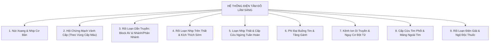

# Kế Hoạch Hoàn Thiện Toàn Diện ECG Lâm Sàng: Bệnh Lý Theo Hệ Thống, Tiêu Chuẩn Vàng, Lưu Đồ Tiếp Cận & Xử Trí Cấp Cứu

Created: 2026-10-22T06:40:00+07:00
Updated: 2026-10-22T06:45:00+07:00 (Phân nhóm bệnh lý theo Hệ thống Y Khoa Lâm Sàng)
Status: ✅ Completed (All 6 Phases Fully Implemented & Tested)
Milestone: M3 (MedSim Core Diagnostic Enhancement)

---

## 1. Phân Nhóm 9 Hệ Thống Bệnh Học Điện Tâm Đồ Lâm Sàng (Systematic Clinical Taxonomy)

Theo các giáo trình Tim Mạch kinh điển (*Braunwald's Heart Disease, Marriott's Practical Electrocardiography, Harrison's Principles of Internal Medicine*) và Hướng dẫn Hội Tim Mạch Học Việt Nam (VNHA), các mặt bệnh lý điện tim đồ được chuẩn hóa theo **9 Hệ Thống Bệnh Học**:



### Chi Tiết 9 Hệ Thống & 30 Mặt Bệnh Lý:

| STT | Mã Hệ Thống (`system_id`) | Tên Hệ Thống Bệnh Học | Danh Sách Các Mặt Bệnh Lý Cụ Thể |
|:---:|---|---|---|
| **I** | `sinus_node` | **Nút Xoang & Nhịp Cơ Bản** | 1. Nhịp xoang bình thường (`normal_sinus`)<br>2. Nhịp chậm xoang (`sinus_bradycardia`)<br>3. Nhịp nhanh xoang (`sinus_tachycardia`) |
| **II** | `acute_coronary` | **Hội Chứng Mạch Vành Cấp (Theo Vùng Cấp Máu)** | 4. STEMI thành dưới - ĐM RCA/LCx (`stemi_inferior`)<br>5. STEMI trước rộng / trước vách - ĐM LAD (`stemi_anterior`)<br>6. STEMI thành bên cao/thấp - ĐM LCx/Diagonal (`stemi_lateral`)<br>7. STEMI thành sau thực thụ - ĐM PDA/RCA (`stemi_posterior`)<br>8. Thiếu máu dưới nội tâm mạc / NSTEMI (`nemi_subendocardial`) |
| **III** | `conduction_blocks` | **Rối Loạn Dẫn Truyền: Block AV & Phân Nhánh** | 9. Block AV độ I (`av_block_first_degree`)<br>10. Block AV độ II Mobitz I - Chu kỳ Wenckebach (`av_block_mobitz_1`)<br>11. Block AV độ II Mobitz II (`av_block_mobitz_2`)<br>12. Block AV độ III hoàn toàn (`av_block_third_degree`)<br>13. Block nhánh phải hoàn toàn - RBBB (`rbbb`)<br>14. Block nhánh trái hoàn toàn - LBBB (`lbbb`)<br>15. Block phân nhánh trái trước - LAFB (`lafb`) |
| **IV** | `supraventricular` | **Rối Loạn Nhịp Trên Thất & Kích Thích Sớm** | 16. Rung nhĩ đáp ứng thất nhanh (`atrial_fibrillation`)<br>17. Cuồng nhĩ dẫn truyền 2:1 (`atrial_flutter`)<br>18. Cơn nhịp nhanh kịch phát trên thất - SVT (`svt`)<br>19. Hội chứng kích thích sớm Wolff-Parkinson-White (`wpw_syndrome`) |
| **V** | `ventricular_arrest` | **Loạn Nhịp Thất & Ngừng Tuần Hoàn** | 20. Ngoại tâm thu thất dày dạng nhịp ba (`pvc_frequent`)<br>21. Cơn nhanh thất đơn dạng - Monomorphic VT (`ventricular_tachycardia`)<br>22. Xoắn đỉnh - Torsades de Pointes (`torsades_de_pointes`)<br>23. Rung thất sóng thô / sóng mịn - VFib (`ventricular_fibrillation`)<br>24. Vô tâm thu - Asystole (`asystole`) |
| **VI** | `chamber_hypertrophy` | **Phì Đại Buồng Tim & Tăng Gánh** | 25. Phì đại thất trái tăng gánh tâm thu - LVH Strain (`lvh_strain`) |
| **VII** | `channelopathies` | **Bệnh Lý Kênh Ion & Nguy Cơ Đột Tử** | 26. Hội chứng Brugada Type 1 coved-type (`brugada_type1`) |
| **VIII** | `cardiopulmonary_pericardial` | **Cấp Cứu Tim Phổi & Màng Ngoài Tim** | 27. Thuyên tắc động mạch phổi cấp S1Q3T3 (`pulmonary_embolism`)<br>28. Viêm màng ngoài tim cấp ST lõm lòng thuyền (`acute_pericarditis`) |
| **IX** | `metabolic_toxicology` | **Rối Loạn Điện Giải & Nhiễm Độc Thuốc** | 29. Tăng Kali máu nặng K+ > 7.0 (`hyperkalemia`)<br>30. Hạ Kali máu nặng K+ < 2.5 (`hypokalemia`)<br>31. Nhiễm độc Digitalis ST đáy chén Salvador Dali (`digoxin_toxicity`) |

---

## 2. Kiến Trúc Dữ Liệu & Giao Diện 2 Cấp (Two-Level System Navigation)

### Cấu Trúc Bảng `ecg_diagnoses` Nâng Cấp:
```sql
ALTER TABLE ecg_diagnoses ADD COLUMN system_id TEXT NOT NULL DEFAULT 'sinus_node';
ALTER TABLE ecg_diagnoses ADD COLUMN system_name TEXT NOT NULL DEFAULT 'Nút Xoang & Nhịp Cơ Bản';
ALTER TABLE ecg_diagnoses ADD COLUMN anatomical_region TEXT; -- RCA, LAD, LCx, His-Purkinje, v.v.
ALTER TABLE ecg_diagnoses ADD COLUMN clinical_presentation_json TEXT NOT NULL DEFAULT '{}';
ALTER TABLE ecg_diagnoses ADD COLUMN emergency_management_json TEXT NOT NULL DEFAULT '{}';
ALTER TABLE ecg_diagnoses ADD COLUMN approach_algorithm_json TEXT NOT NULL DEFAULT '{}';
ALTER TABLE ecg_diagnoses ADD COLUMN red_flags_json TEXT NOT NULL DEFAULT '{}';
ALTER TABLE ecg_diagnoses ADD COLUMN patient_case_json TEXT NOT NULL DEFAULT '{}';
```

### Thiết Kế Giao Diện Điều Hướng Phân Cấp (Hierarchical UI):
- **Cấp 1 - Thanh Hệ Thống (System Selector Bar):** Cho phép người học chọn nhanh giữa 9 hệ thống lâm sàng với biểu tượng chuyên biệt và đếm số lượng ca bệnh.
- **Cấp 2 - Thẻ Bệnh Lý Trong Hệ Thống (Pathology Cards):** Hiển thị các mặt bệnh trực thuộc hệ thống đó, kèm mức độ nguy kịch (`CODE RED`, `CẤP CỨU`, `THEO DÕI`).
- **Cấp 3 - Bản In Giấy Hồng & Lưu Đồ 7 Bước:** Giấy in 12 chuyển đạo hiển thị tiêu chuẩn đã phân loại theo hệ thống, cùng bảng xử trí cấp cứu và ca bệnh lâm sàng tương ứng.

---

## 3. Lộ Trình Triển Khai 6 Phases (Updated)

| Phase | Tên Phase & Nội Dung Trọng Tâm | Status | Tasks | Tiến Độ |
|:---:|---|:---:|:---:|:---:|
| **01** | **Database Schema & 9-System Pathology Expansion:** Mở rộng schema CSDL SQLite với `system_id`, `system_name`, `anatomical_region` và nạp toàn bộ 31 mặt bệnh lý chuẩn theo 9 hệ thống. | ✅ Complete | 5 tasks | 100% |
| **02** | **Waveform Generators & Dynamic Annotations:** Sinh sóng toán học Gaussian cho các bệnh lý mới trong từng hệ thống & định nghĩa mảng nhãn ánh xạ chính xác trên 12 chuyển đạo. | ✅ Complete | 5 tasks | 100% |
| **03** | **Systematic Clinical Approach & Emergency Protocols:** Lõi nghiệp vụ quy trình đọc ECG 7 bước, thuật toán phân biệt hội chứng, danh mục thuốc tim mạch và bảng cạm bẫy lâm sàng cấm kỵ. | ✅ Complete | 4 tasks | 100% |
| **04** | **Two-Level System Navigation & Clinical Drawer UI:** Giao diện chọn lọc theo 9 hệ thống y khoa lâm sàng, Drawer phân tích ca bệnh, bảng cảnh báo đỏ và trợ lý 7 bước trực tiếp trên giấy in hồng. | ✅ Complete | 4 tasks | 100% |
| **05** | **Clinical Patient Cases & Module 3 ER Ward Sync:** Tích hợp hồ sơ ca bệnh mẫu của từng hệ thống và nút chuyển thẳng vào buồng hồi sức cấp cứu Module 3. | ✅ Complete | 4 tasks | 100% |
| **06** | **Verification, Automated Testing & Documentation:** Kiểm thử tự động tính nhất quán của 9 hệ thống, độ mượt 60 FPS Canvas và cập nhật tài liệu y khoa. | ✅ Complete | 4 tasks | 100% |

---

## 4. Các Lệnh Thực Hiện Nhanh (Quick Commands)
- Bắt đầu triển khai Phase 1: `/code phase-01`
- Kiểm tra tiến độ: `/next`
- Lưu trạng thái: `/save-brain`
