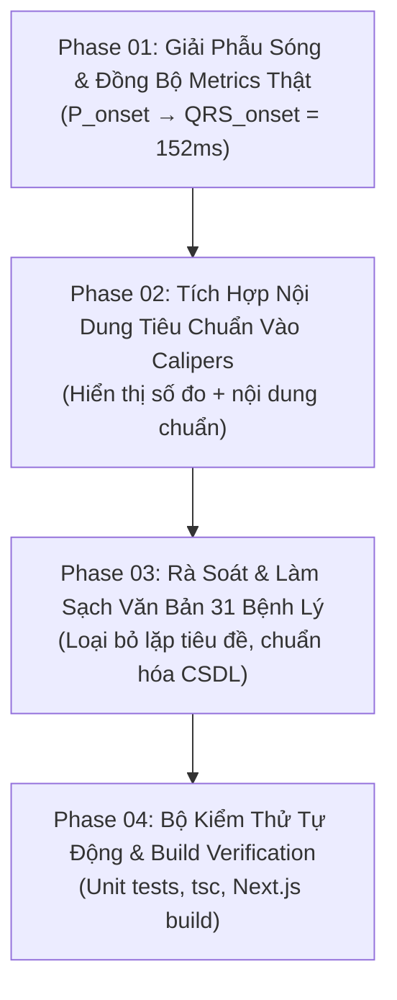

# Kế Hoạch Milestone M9: Chuẩn Hóa Khớp 100% Nội Dung Tiêu Chuẩn Chẩn Đoán Với Thước Đo Giải Phẫu Sóng & Số Đo Điện Tim

> **Phiên bản:** 1.0  
> **Mã kế hoạch:** `PLAN-M9-ECG-CRITERIA-PRECISION`  
> **Trạng thái:** Chờ Bác sĩ / User phê duyệt (Phase 1 Planning)

---

## 1. Bối Cảnh & Phân Tích Nguyên Nhân Gốc Rễ (Root Cause Analysis)

Từ hình ảnh thực tế Bác sĩ cung cấp:
- **Header thông số bệnh nhân:** `HR: 75 bpm   PR: 152ms   QRS: 84ms   QT/QTc: 384/429ms`
- **Tiêu chuẩn được chọn:** `[✓] 3. Khoảng PR bình thường: Cố định và bình thường từ 0.12s đến 0.20s (3 - 5 ô nhỏ)`
- **Hiển thị thực tế trên đường điện tim:**
  - Thước kẹp hiện: `|<── PR = 128ms (3.2 ô nhỏ) ──>|`
  - Vị trí thước kẹp: Bắt đầu từ **đỉnh sóng P** ($0.12s$) và kéo dài đến tận **đoạn ST** ($0.28s$), trùm lên toàn bộ phức bộ QRS.
  - Nội dung tiêu chuẩn: Bị vứt bỏ hoàn toàn, không thể hiện tiêu chuẩn bình thường là gì ($0.12s - 0.20s$, cố định).

### 4 Sai Lệch Lâm Sàng Trọng Yếu:
1. **Sai lệch số đo (Clinical Metric Mismatch):** Header tính toán PR của bệnh nhân là **152 ms** (dựa vào `metrics.prIntervalMs`), nhưng thước kẹp trên sóng lại tính độc lập theo phase tùy tiện $((0.28 - 0.12) \times 0.8s = 128\text{ms})$, gây mâu thuẫn trực tiếp giữa Header và Sóng.
2. **Sai lệch giải phẫu sóng (Anatomical Waveform Misplacement):**
   - Khoảng PR trên điện tâm đồ được định nghĩa từ **khởi đầu sóng P** ($P_{\text{onset}}$) đến **khởi đầu phức bộ QRS** ($QRS_{\text{onset}}$).
   - Hiện tại thước kẹp gán từ đỉnh P sang đoạn ST.
3. **Mất nội dung tiêu chuẩn (Loss of Criteria Context):** Khi click vào tiêu chuẩn, thước chỉ in một nhãn cụt lủn `PR = 128ms`, không diễn giải nội dung tiêu chuẩn y khoa đã ghi ở bảng chọn phía trên.
4. **Văn bản tiêu chuẩn bị lặp từ (Text Redundancy):** Một số tiêu chuẩn trong CSDL bị lặp tiêu đề (ví dụ: *"2. Sóng P âm ở aVR: Sóng P âm ở aVR, dương ở DI, DII, aVF"*).

---

## 2. Mục Tiêu Của Milestone M9

1. **Khớp 100% số đo Header - Sóng - Tiêu chuẩn:** Số đo trên thước kẹp PR, QRS, QT, R-R phải lấy trực tiếp từ `metrics` thực tế của bệnh nhân (`metrics.prIntervalMs`, `metrics.qrsDurationMs`, `metrics.qtIntervalMs`, `metrics.heartRate`).
2. **Định vị giải phẫu chính xác tuyệt đối:**
   - Thước PR: Bắt đầu từ chân trước sóng P ($P_{\text{onset}}$) đến chân sóng Q/R ($QRS_{\text{onset}}$), có 2 vạch gióng mảnh nét đứt nối trực tiếp từ chân sóng xuống thước đo.
   - Thước QRS: Bắt đầu từ $QRS_{\text{onset}}$ đến điểm J ($J_{\text{point}}$).
   - Thước QT: Bắt đầu từ $QRS_{\text{onset}}$ đến điểm kết thúc sóng T ($T_{\text{end}}$).
   - Thước R-R: Nối từ đỉnh $R_k$ đến đỉnh $R_{k+1}$.
3. **Hiển thị đầy đủ nội dung tiêu chuẩn chẩn đoán:** Nhãn trên đường điện tim phải thể hiện rõ: **[Số đo thực tế] • [Nội dung tiêu chuẩn AHA/ESC]**.
4. **Làm sạch văn bản tiêu chuẩn cho toàn bộ 31 bệnh lý:** Chuẩn hóa câu từ trong CSDL SQLite, triệt tiêu lặp tiêu đề, rà soát đồng bộ 100%.

---

## 3. Các Giai Đoạn Triển Khai (Phases Breakdown)

### Phase 01: Chuẩn Hóa Giải Phẫu Sóng & Đồng Bộ Thước Đo Với Bệnh Nhân (`metrics`)
- **Tập tin:** `src/components/simulators/ecg/RealisticPinkEcgPaper.tsx`
- **Nội dung:**
  - Nhận diện thời điểm giải phẫu từ chu kỳ tim:
    - Đỉnh sóng R tại $t_R = (k + 0.22) \times \text{cycleDuration}$.
    - Chân bắt đầu QRS: $t_{\text{QRS\_start}} = t_R - (\text{metrics.qrsDurationMs} / 2000)$.
    - Điểm J kết thúc QRS: $t_{\text{QRS\_end}} = t_{\text{QRS\_start}} + (\text{metrics.qrsDurationMs} / 1000)$.
    - Chân bắt đầu sóng P: $t_{P\_\text{start}} = t_{\text{QRS\_start}} - (\text{metrics.prIntervalMs} / 1000)$.
    - Kết thúc sóng T: $t_{T\_\text{end}} = t_{\text{QRS\_start}} + (\text{metrics.qtIntervalMs} / 1000)$.
  - Tọa độ $x_1, x_2$ của thước PR: $x_1 = \text{traceStart} + (t_{P\_\text{start}} - t_{\text{min}}) \times \text{pixelsPerSecond}$, $x_2 = \text{traceStart} + (t_{\text{QRS\_start}} - t_{\text{min}}) \times \text{pixelsPerSecond}$.
  - Vạch gióng dọc nét đứt từ chân sóng P và chân sóng Q xuống thước caliper.
  - Độ dài $\Delta x$ trên canvas luôn tính ra đúng $\text{metrics.prIntervalMs}$ (152 ms = 3.8 ô nhỏ).

### Phase 02: Tích Hợp Nội Dung Tiêu Chuẩn Vào Nhãn & Thước Đo Canvas
- **Tập tin:** `src/components/simulators/ecg/RealisticPinkEcgPaper.tsx`
- **Nội dung:**
  - **Thước PR:**
    `|<── PR = 152ms (3.8 ô nhỏ) • Tiêu chuẩn: Cố định 0.12s - 0.20s ──>|`
    (Trong Block AV I: `|<── PR = 260ms (6.5 ô nhỏ) • Tiêu chuẩn: Kéo dài cố định > 0.20s ──>|`)
  - **Thước R-R:**
    `|<── R-R = 800ms (4.0 ô lớn) • 75 bpm • Tiêu chuẩn: Đều 60 - 100 bpm ──>|`
    (Trong Rung nhĩ: `|<── R-R không đều: 480 - 920ms • Tiêu chuẩn: Loạn nhịp hoàn toàn ──>|`)
  - **Thước QRS:**
    `|<── QRS = 84ms (2.1 ô nhỏ) • Tiêu chuẩn: QRS hẹp < 120ms ──>|`
  - **Biên độ ST / T:**
    `▲ ST chênh lên +3.5mm (0.35 mV) • Tiêu chuẩn: ST chênh vòm > 1mm`
    `▼ ST soi gương -1.8mm (-0.18 mV) • Tiêu chuẩn: ST chênh xuống`
    `▲ Sóng T = +11.5mm (1.15 mV) • Tiêu chuẩn: T lều cao nhọn > 10mm`
  - **Hình thái sóng P:**
    - aVR: `▼ Sóng P âm ở aVR (-0.12 mV) • Tiêu chuẩn: P luôn âm ở aVR`
    - DI/DII/aVF: `▲ Sóng P dương ở DII (+0.15 mV) • Tiêu chuẩn: P xoang dương DI, DII, aVF`

### Phase 03: Rà Soát & Làm Sạch Văn Bản Tiêu Chuẩn Cho Toàn Bộ 31 Bệnh Lý
- **Tập tin:**
  - `scripts/seed_ecg_comprehensive_diagnoses.js`
  - `scripts/comprehensive_annotations_data.js`
  - `src/domain/simulators/ecgAnnotationsData.ts`
  - CSDL `data/medsim.db`
- **Nội dung:**
  - Làm sạch các tiêu chuẩn bị lặp tiền tố:
    - Cũ: `"Sóng P âm ở aVR: Sóng P âm ở aVR, dương ở DI, DII, aVF"`
    - Mới: `"Trục sóng P bình thường: Dương ở DI, DII, aVF; Luôn luôn âm ở aVR"`
  - Kiểm tra toàn bộ 139 tiêu chuẩn của 31 mặt bệnh, đảm bảo định dạng: `[Tên tiêu chuẩn]: [Mô tả chi tiết và ngưỡng giá trị y khoa]`.
  - Re-seed và cập nhật SQLite database `data/medsim.db`.

### Phase 04: Bộ Kiểm Thử Tự Động & Build Verification
- **Tập tin:** `tests/precision_criteria_and_calipers.test.js`
- **Nội dung kiểm thử:**
  1. Kiểm tra số đo thước PR caliper khớp đúng `metrics.prIntervalMs` (152ms = 3.8 ô nhỏ cho Normal Sinus, 260ms cho Block AV I).
  2. Kiểm tra thước PR caliper bắt đầu tại chân sóng P và kết thúc tại chân sóng Q.
  3. Kiểm tra nhãn calipers và annotations chứa đúng nội dung tiêu chuẩn y khoa khi được kích hoạt.
  4. Kiểm tra CSDL không còn tiêu chuẩn bị lặp tiền tố.
  5. Chạy toàn bộ 28+ test suites: `npm test` passed 100%.
  6. `npx tsc --noEmit` đạt 0 lỗi TypeScript.
  7. `npm run build` thành công Next.js production.

---

## 4. Cam Kết Trinity Protocol
- ⛔ **Không bắt đầu viết code implementation** cho đến khi Bác sĩ duyệt kế hoạch này.
- Giữ nguyên toàn vẹn dữ liệu SQLite và cấu trúc Clean Architecture.
- Bác sĩ chỉ cần bấm duyệt hoặc gõ `ok` / `/code` để bắt đầu triển khai.
