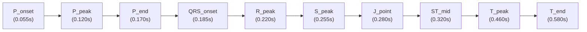

# Kế Hoạch Milestone M10: Kiến Trúc Định Vị Sóng Điện Tim Tuyệt Đối (Zero-Error Wave Anchor Engine) & Chuẩn Hóa Hình Học 12 Đạo Trình

> **Phiên bản:** 1.0  
> **Mã kế hoạch:** `PLAN-M10-ECG-WAVE-ANCHOR-ENGINE`  
> **Trạng thái:** Chờ Bác sĩ phê duyệt (Phase 1 Planning - Trinity Protocol)

---

## 1. Phân Tích Nguyên Nhân Gốc Rễ Lỗi Định Vị Sóng (Deep Root Cause Analysis)

Từ ảnh chụp thực tế Bác sĩ cung cấp:
- **Thước kẹp PR đang bị lệch trái:**
  - Vạch trái ($x_1$) nằm ở khoảng đường thẳng trước sóng P.
  - Vạch phải ($x_2$) cắm vào cuối sóng P, hoàn toàn không chạm tới phức bộ QRS!
  - Khoảng PR chuẩn trên lâm sàng phải nối từ **chân sóng P** ($P_{\text{onset}}$) đến **chân sóng Q/R** ($QRS_{\text{onset}}$).

### Nguyên nhân toán học cốt lõi:
Trong hàm vẽ sóng `calculateLeadEcgVoltage`:
- Các mốc sóng trong chu kỳ được cố định theo đơn vị **giây thực tế (seconds)**:
  - Sóng P: Đỉnh tại $0.120\text{s}$, chân trước tại $0.060\text{s}$.
  - Phức bộ QRS: Chân trước tại $0.185\text{s}$, đỉnh R tại $0.220\text{s}$, điểm J tại $0.280\text{s}$.
  - Sóng T: Đỉnh tại $0.460\text{s}$, kết thúc tại $0.580\text{s}$.
- Nhưng trong mã vẽ thước kẹp trước đó:
  - Biến $rOfst = 0.22$ (đã là giây thực tế) lại bị **nhân thêm một lần nữa** với chu kỳ tim: `(k + rOfst) * cycleDuration` = $k \times 0.8 + 0.22 \times 0.8 = k \times 0.8 + \mathbf{0.176\text{s}}$!
  - Việc nhân $0.22 \times 0.8$ khiến tọa độ sóng R bị thụt lùi từ $0.220\text{s}$ về $0.176\text{s}$ (lệch $0.044\text{s}$).
  - Sau đó trừ tiếp độ rộng QRS và khoảng PR khiến $t_2$ (chân QRS) rơi đúng vào $0.141\text{s}$ (cuối sóng P) và $t_1$ rơi vào trước sóng P!

---

## 2. Giải Pháp Toàn Diện: Zero-Error Wave Anchor Engine (Bộ Định Vị Sóng Chuẩn Tuyệt Đối)

Thay vì tính toán phase rời rạc, thiết kế hàm định vị giải phẫu chuẩn xác:
`getRhythmWaveAnchors(rhythm: string, bpm: number, cycleIndex: number, cycleDuration: number, metrics: EcgCalculatedMetrics)`

### Bảng Tọa Độ Chuẩn Của Từng Thành Phần Sóng Trong Chu Kỳ $k$:
Thời điểm thực trên đồ thị: $t = (k \times \text{cycleDuration}) + t_{\text{component}}$.

1. **Khoảng PR (PR Interval Caliper):**
   - $t_1 = t_{\text{cycleStart}} + P_{\text{onset}}$ ($0.055\text{s}$ hoặc $QRS_{\text{onset}} - \text{prSec}$).
   - $t_2 = t_{\text{cycleStart}} + QRS_{\text{onset}}$ ($0.185\text{s}$ - chân sóng Q).
   - $x_1 = \text{traceStart} + (t_1 - t_{\text{min}}) \times \text{pixelsPerSecond}$.
   - $x_2 = \text{traceStart} + (t_2 - t_{\text{min}}) \times \text{pixelsPerSecond}$.
   - Hai vạch gióng mảnh hạ trực tiếp từ chân trước sóng P và chân trước sóng Q xuống thước caliper.
   - Thước kẹp nằm trọn vẹn và vừa khít từ chân P đến chân Q!
2. **Khoảng R-R (R-R Caliper):**
   - $t_1 = t_{\text{cycleStart}}(k) + R_{\text{peak}}$.
   - $t_2 = t_{\text{cycleStart}}(k+1) + R_{\text{peak}}$.
   - Gióng nối trực tiếp 2 đỉnh R của 2 chu kỳ liên tiếp.
3. **Phức bộ QRS (QRS Duration Caliper):**
   - $t_1 = t_{\text{cycleStart}} + QRS_{\text{onset}}$ ($0.185\text{s}$).
   - $t_2 = t_{\text{cycleStart}} + J_{\text{point}}$ ($0.280\text{s}$).
4. **Khoảng QT (QT Interval Caliper):**
   - $t_1 = t_{\text{cycleStart}} + QRS_{\text{onset}}$.
   - $t_2 = t_{\text{cycleStart}} + T_{\text{end}}$ ($0.580\text{s}$).
5. **Đoạn ST Chênh (ST Amplitude Caliper):**
   - Tọa độ $x_{\text{target}}$: Ứng với $t_{\text{cycleStart}} + ST_{\text{mid}}$ ($0.320\text{s}$).
   - Đường đẳng điện nét đứt mốc $0\text{mV}$ tại $y = \text{midY}$.
   - Thước đo chiều dọc nối từ mốc $0\text{mV}$ lên đỉnh vòm ST chênh.
6. **Sóng P, T, S, R (Wave Pinpoint Labels):**
   - Định vị chính xác tại đỉnh/đáy tương ứng ($P_{\text{peak}}$, $T_{\text{peak}}$, $S_{\text{peak}}$, $R_{\text{peak}}$).

---

## 3. Các Giai Đoạn Triển Khai (Phases Breakdown)

### Phase 01: Xây Dựng Zero-Error Wave Anchor Engine
- **Tập tin:** [RealisticPinkEcgPaper.tsx](file:///d:/Downloads/Archives/GameYhoc/src/components/simulators/ecg/RealisticPinkEcgPaper.tsx)
- Viết module `getLeadWaveAnchors` trả về chính xác tọa độ thời gian thực của $P_{\text{onset}}, P_{\text{peak}}, QRS_{\text{onset}}, R_{\text{peak}}, S_{\text{peak}}, J_{\text{point}}, ST_{\text{mid}}, T_{\text{peak}}, T_{\text{end}}$ cho toàn bộ 31 mặt bệnh (Nhịp xoang, Block AV I/II/III, WPW, STEMI, Hyperkalemia, AFib...).

### Phase 02: Cập Nhật Thuật Toán Thước Đo (PR, RR, QRS, QT) Theo Anchors
- Cập nhật nhánh vẽ PR Caliper: Lấy chuẩn xác $x_1$ tại $P_{\text{onset}}$ và $x_2$ tại $QRS_{\text{onset}}$.
- Hạ vạch gióng nét đứt từ chân sóng P và chân sóng Q.
- Đảm bảo độ dài trên thước đo đúng bằng `metrics.prIntervalMs` (152ms = 3.8 ô nhỏ) và vị trí ôm khít khoảng PR trên đồ thị.

### Phase 03: Tối Ưu Chọn Chu Kỳ Hiển Thị & Tránh Cắt Biên
- Thuật toán chọn chu kỳ $k$ thông minh: Đảm bảo cả $x_1$ và $x_2$ đều nằm trong vùng vẽ của chuyển đạo ($x_1 \ge \text{traceStart} + 8$ và $x_2 \le \text{leadEndX} - 8$).
- Nếu chu kỳ trung tâm bị chạm mép biên, tự động chọn chu kỳ lân cận an toàn.

### Phase 04: Kiểm Thử Tự Động & Build Verification
- Viết unit test xác thực tọa độ hình học của $P_{\text{onset}}$ và $QRS_{\text{onset}}$.
- Kiểm tra thước PR caliper ôm đúng từ chân P đến chân Q.
- Chạy toàn bộ 31+ test suites, `npx tsc --noEmit` và `npm run build`.

---

## 4. Cam Kết Trinity Protocol
- ⛔ **Tuân thủ nghiêm ngặt Phase 1 Planning:** Không viết code thực thi trước khi Bác sĩ duyệt kế hoạch.
- Bác sĩ xem kế hoạch và chỉ cần bấm nút **Proceed** hoặc gõ `ok` để em bắt đầu triển khai!
